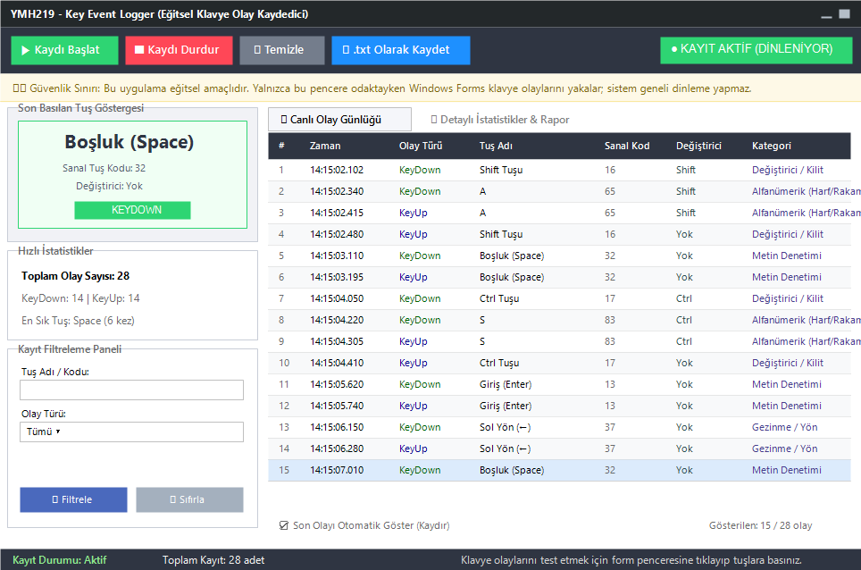
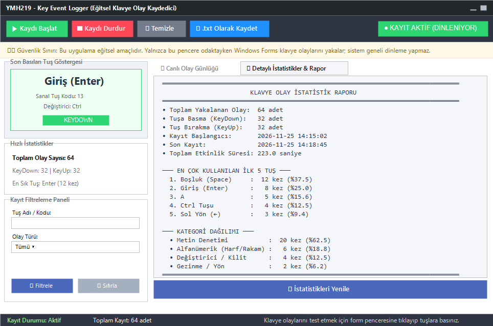

# YMH219 - Key Event Logger (Eğitsel Klavye Olay Kaydedici)

Bu proje, **Nesne Tabanlı Programlama (YMH 219)** dersi kapsamında geliştirilmiş, Windows Forms ve C# tabanlı bir eğitsel klavye olay dinleme ve analiz uygulamasıdır. Proje; form seviyesinde klavye olaylarının (`KeyDown` ve `KeyUp`) nasıl yakalandığını, olay bilgilerinin nesne tabanlı bir modelde nasıl kapsüllendiğini, çalışma zamanı istatistiklerinin çıkarılmasını ve `StreamWriter` ile yerel metin dosyalarına (`.txt`) güvenli aktarımını gösterir.

---

## 🛡️ Kapsam ve Güvenlik Sınırı Bildirimi

> [!IMPORTANT]
> **Bu ödev gerçek bir sistem keyloggerı DEĞİLDİR.**
> - Uygulama **yalnızca kendi form penceresi odaktayken (aktifken)** klavye olaylarını yakalar.
> - Global keyboard hook (WH_KEYBOARD_LL), arka planda/gizli çalışma, Windows başlangıcında otomatik başlama, parola/kimlik bilgisi yakalama, başka pencerelerden veri toplama veya ağ üzerinden veri aktarımı **kesinlikle içermez ve yapılmamıştır**.
> - Amaç tamamen Windows Forms girdi yönetimi ve nesne yönelimli dosya I/O mimarisinin kavranmasıdır.

---

## 📋 Proje Bilgileri ve Öğrenci Bilgisi

- **Ders:** Nesne Tabanlı Programlama (YMH 219)
- **Ödev Konusu:** Ödev 4 — Key Event Logger (Eğitsel Keylogger)
- **Geliştirici / Öğrenci:** Abdullah Gümüş (`agumusfu`)
- **Öğrenci Numarası:** 250542016
- **Platform / Çatı:** .NET 8.0 Windows Desktop (C# 12)
- **Arayüz Teknolojisi:** Windows Forms (WinForms)

---

## 📸 Ekran Görüntüleri

### 1. Canlı Klavye Olay Günlüğü ve Görsel Tuş Rozeti
Aşağıda form odaktayken basılan tuşların anlık yakalanması, değiştirici tuş analizi (`Ctrl`, `Alt`, `Shift`), sanal tuş kodları ve sol paneldeki 3D görsel tuş rozeti görülmektedir:



### 2. İstatistik Raporu ve Gelişmiş Filtreleme Paneli
Kullanıcının klavye kullanım alışkanlıklarını analiz eden frekans raporu, kategori dağılımı ve tarih/tuş filtreleme paneli:



---

## 🚀 Uygulamanın Temel Özellikleri

### Asgari Gereksinimler
- **Odaklı Klavye Dinleme:** Form aktifken basılan tuş adı, zaman bilgisi (`HH:mm:ss.fff`), sanal tuş kodu ve değiştiriciler DataGridView ve panel üzerinde anlık listelenir.
- **Kayıt Kontrolü (Başlat / Durdur):** `▶ Kaydı Başlat` ve `⏹ Kaydı Durdur` butonları ile olay yakalama dinamik olarak yönetilir.
- **Ekranı Temizleme:** `🗑 Temizle` butonu ile kullanıcı onayından sonra ekrandaki tüm kayıtlar ve istatistikler sıfırlanır.
- **.txt Dosyasına Aktarma:** `💾 .txt Olarak Kaydet` butonu ile `StreamWriter` sınıfı kullanılarak tüm kayıtlar ve detaylı istatistik özeti formatlanmış bir metin dosyasına yazılır.
- **Açık Durum Göstergesi:** Başlık çubuğunda ve durum çubuğunda kaydın aktif veya durdurulmuş olduğunu belirten renkli dinamik rozetler yer alır (`● KAYIT AKTİF` / `○ KAYIT DURDURULDU`).

### İsteğe Bağlı Ek Geliştirmeler (Bonus Özellikler)
- 📊 **Detaylı İstatistik Analizi:** Toplam tuş sayısı, KeyDown/KeyUp oranları, en sık basılan ilk 10 tuş ve tuş kategorisi dağılımı hesaplanır.
- 🔍 **Gelişmiş Filtreleme:** Olaylar tuş adına, olay türüne (`KeyDown` / `KeyUp`) veya saat aralığına göre filtrelenebilir.
- ⌨️ **Görsel Tuş Rozeti (Visual Key Badge):** Basılan tuşun adını, sanal kodunu ve olay türünü anlık olarak görselleştiren animasyonlu mekanik tuş göstergesi.
- ⚡ **Klavye Kısayolları:**
  - `F5`: Kaydı Başlat
  - `F6`: Kaydı Durdur
  - `F7`: Kayıtları Temizle
  - `Ctrl + S`: .txt Olarak Dışa Aktar
  - `Ctrl + F`: Arama kutusuna odaklan

---

## 🛠️ Kullanılan Teknolojiler ve Mimarî Yapı

- **Programlama Dili:** C# (.NET 8.0-windows)
- **Arayüz:** Windows Forms (`System.Windows.Forms`)
- **Dosya Giriş / Çıkış (I/O):** `System.IO.StreamWriter`, `System.Text.Encoding.UTF8`
- **Veri Mimarisi:** LINQ sorguları, DataTable, strongly-typed modelleme
- **Harici Paket İhtiyacı:** Bulunmamaktadır (Tamamen standart .NET SDK kütüphaneleriyle derlenir).

### Sınıf Mimarisi (OOP Tasarımı)

```
src/KeyEventLogger/
├── Models/
│   ├── KeyEventRecord.cs    # Tekil olay modeli (Tuş, Zaman, Kod, Değiştirici, Kategori)
│   └── KeyStatistics.cs     # Frekans analizi ve rapor üreten istatistik veri modeli
├── Services/
│   ├── KeyLogService.cs     # Olay yakalama, durum yönetimi, filtreleme ve LINQ istatistik motoru
│   └── FileExportService.cs # StreamWriter ile güvenli .txt dosya yazma servisi
├── MainForm.cs              # WinForms olay bağlayıcı, klavye dinleyicisi ve UI koordinatörü
├── MainForm.Designer.cs     # Görsel bileşen tanımları (Toolbar, SplitContainer, Grid, Tabs)
└── Program.cs               # Güvenli hata yakalamalı başlangıç noktası
```

---

## ⚙️ Kurulum ve Çalıştırma Adımları

### Gereksinimler
- [.NET 8.0 SDK](https://dotnet.microsoft.com/download/dotnet/8.0) veya üzeri
- Visual Studio 2022 veya Visual Studio Code
- Windows 10 / Windows 11 işletim sistemi

### Adım 1: Depoyu Klonlayın
```bash
git clone https://github.com/agumusfu/YMH219-KeyEventLogger.git
cd YMH219-KeyEventLogger
```

### Adım 2: Çözümü Visual Studio ile Açma
- `YMH219-KeyEventLogger.sln` dosyasına çift tıklayarak projeyi Visual Studio'da açın.
- `F5` tuşuna basarak projeyi derleyip çalıştırın.

### Adım 3: Terminal (.NET CLI) ile Çalıştırma
```bash
dotnet build
dotnet run --project src/KeyEventLogger/KeyEventLogger.csproj
```

---

## ⚠️ Bilinen Sınırlamalar ve Geliştirme Notları

1. **Yalnızca Odaklı Pencere:** Dersin güvenlik yönergesi gereği form aktif pencere değilken klavye olayları yakalanmaz.
2. **Klavye Düzeni Uyumluluğu:** Türkçe Q klavye, F klavye ve İngilizce klavye sanal tuş kodlarını evrensel Windows sanal kodları (`VK_*`) üzerinden doğru şekilde haritalandırır.
3. **Dosya İzinleri:** Dışa aktarma işlemi sırasında yetkisiz klasörlere yazma hatası durumunda kullanıcıya anlaşılır hata mesajı verilir; program çökmez.
